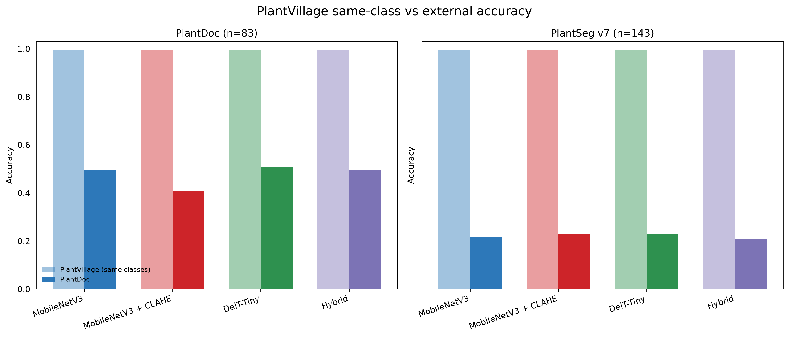
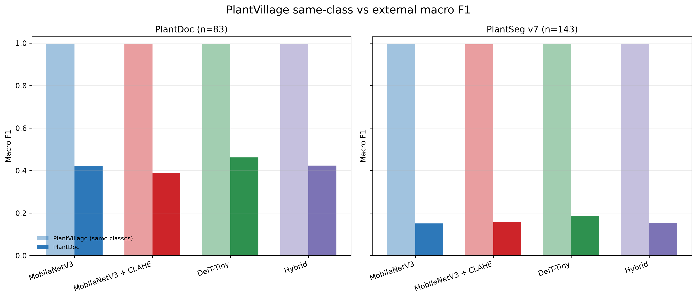
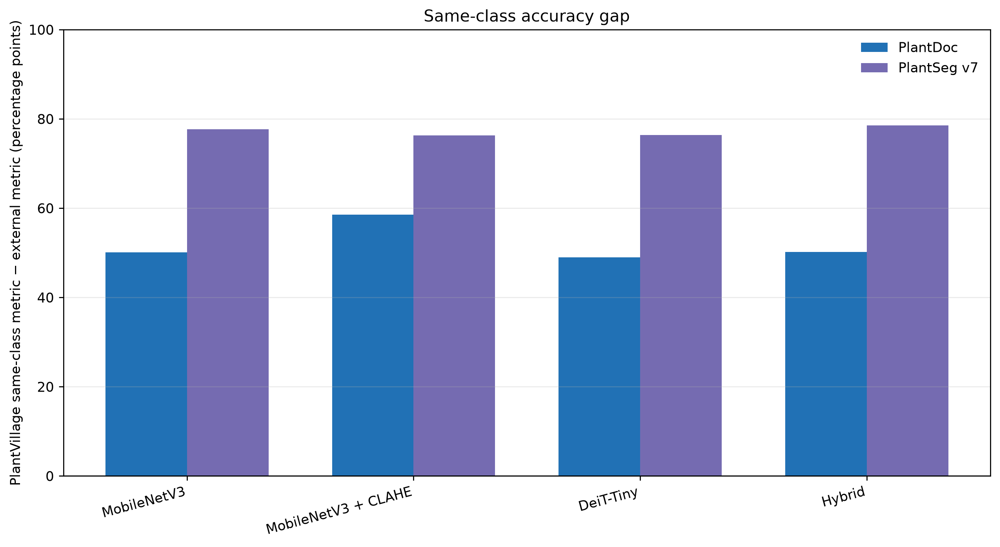
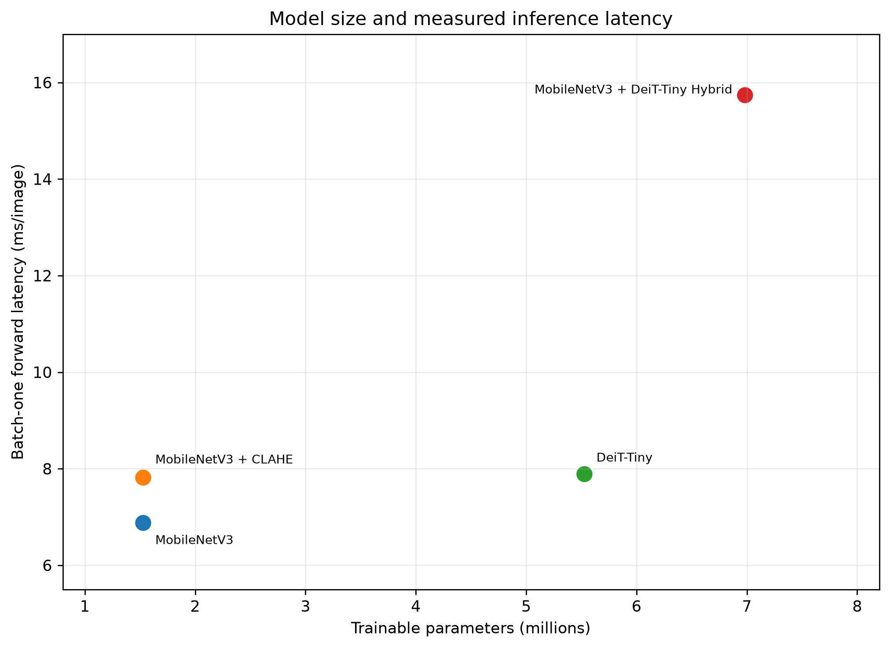

# Cross-Dataset Evaluation of Plant-Disease Classifiers Under Domain Shift: A Comparative Study of CNN, Transformer, Preprocessing, and Feature-Fusion Models

**AUTHOR NAME 1**, **AUTHOR NAME 2**, **AUTHOR NAME 3**  
Department of Computer Science and Engineering  
INSTITUTION NAME  
City, Country  
`author1@example.com`, `author2@example.com`, `author3@example.com`

---

## Abstract
Deep learning architectures for visual plant-disease classification frequently achieve near-ceiling accuracy on benchmark datasets captured under controlled laboratory or uniform background conditions. However, their ability to transfer to field imagery captured under heterogeneous environmental conditions remains a primary barrier to practical agricultural deployment. In this work, we present a systematic, reproducible cross-dataset evaluation comparing four frozen plant-disease classification models: a lightweight convolutional neural network (MobileNetV3-Small), a Contrast Limited Adaptive Histogram Equalization (CLAHE)-enhanced CNN variant, a vision transformer (DeiT-Tiny), and a heterogeneous MobileNetV3–DeiT-Tiny feature-fusion hybrid. All four models were trained on a controlled ten-class PlantVillage-derived dataset (7,647 training, 845 validation, and 2,054 test images), achieving 99.51%–99.66% test accuracy. To evaluate domain transfer, we tested all frozen checkpoints without fine-tuning on two external, mapped benchmark splits: PlantDoc (83 images across 9 compatible classes) and PlantSeg v7 (143 images across 7 compatible classes). Performance degraded severely across all models: PlantDoc accuracy dropped to 40.96%–50.60% (macro F1 38.83%–46.15%), while PlantSeg v7 accuracy dropped to 20.98%–23.08% (macro F1 15.10%–18.62%). Although DeiT-Tiny obtained the highest point estimates of external macro F1 on both external subsets (46.15% on PlantDoc and 18.62% on PlantSeg v7), paired stratified bootstrap confidence intervals and exact McNemar tests established no statistically reliable performance ordering between DeiT-Tiny and the feature-fusion hybrid (+1.20 percentage points accuracy difference on PlantDoc, 95% CI [-6.02, 7.23], two-sided p=1.00; +2.10 points accuracy difference on PlantSeg v7, 95% CI [-4.20, 8.39], Holm-adjusted p=1.00). Furthermore, maximum softmax confidence scores exhibited substantial error rates under domain shift, with 42.0%–52.8% of PlantDoc predictions and 67.6%–80.0% of PlantSeg v7 predictions at $\ge 0.90$ confidence being incorrect. Qualitative Grad-CAM++ visualizations reveal that domain-shift errors correlate with background clutter and non-lesion visual features. Our findings demonstrate that near-ceiling controlled-domain performance does not translate directly to external robustness and underscore the necessity of rigorous cross-dataset benchmarking.

**Keywords:** Plant disease classification, domain shift, cross-dataset evaluation, MobileNetV3, DeiT-Tiny, feature fusion, explainability, Grad-CAM++.

---

## I. INTRODUCTION

Fungal, bacterial, and viral plant pathogens represent a persistent threat to global food security, accounting for an estimated 20% to 40% of annual crop yield losses worldwide [1]. Rapid and accurate identification of foliar disease symptoms is essential for enabling timely localized interventions and mitigating crop loss. Over the past decade, computer vision techniques powered by deep convolutional neural networks (CNNs) and vision transformers (ViTs) have achieved remarkable success in automated plant-disease diagnosis [2]–[4]. Published models routinely report classification accuracies exceeding 99% on benchmark datasets such as PlantVillage [5].

However, a growing body of evidence suggests that these near-perfect benchmark scores mask severe vulnerabilities to dataset shift—the discrepancy between the training data distribution and the deployment environment [6], [7]. Benchmarks like PlantVillage predominantly feature individual leaves excised from plants, positioned against uniform backgrounds, and imaged under standardized laboratory lighting. Conversely, real-world farm deployment demands model robustness against uncontrolled lighting variations, complex canopy backgrounds, shadow artifacts, moisture patterns, leaf overlaps, blur, and varied sensor characteristics [8], [9].

When deployed in unconstrained field environments, classifiers trained exclusively on lab-acquired imagery often experience dramatic performance degradation. Spurious correlations between uniform laboratory backgrounds and specific disease labels can cause models to rely on context rather than genuine diagnostic lesions [10]. To address dataset shift, recent research has explored diverse strategies, including classical image preprocessing enhancements such as Contrast Limited Adaptive Histogram Equalization (CLAHE) [11], self-attention architectures like Vision Transformers [12], and hybrid architectures combining local CNN feature representations with global Transformer attention representations [13].

Despite these architectural developments, open research questions remain regarding how lightweight CNNs, vision transformers, preprocessing interventions, and CNN–Transformer hybrids compare when subjected to zero-shot cross-dataset evaluation on heterogeneous external imagery. Specifically, critical secondary questions include:
1. Does CLAHE preprocessing improve transfer performance when evaluated under domain shift?
2. Does heterogeneous feature fusion of local CNN and global vision transformer features enhance cross-domain generalization?
3. What is the magnitude of the domain gap between controlled laboratory benchmarks and external field-oriented image collections?
4. What visual failure modes occur under dataset shift, and do high maximum-softmax confidence scores remain reliable indicators of correctness?
5. What visual focus patterns are revealed through explainability tools such as Grad-CAM++ across model branches?
6. What are the parameter and computational latency trade-offs associated with these distinct architectural strategies?

In this manuscript, we present a systematic empirical investigation addressing these questions within the LeafGuard research framework. We perform a quantitative and qualitative cross-dataset evaluation of four pre-trained, frozen classifiers: MobileNetV3-Small [14], MobileNetV3-Small with CLAHE preprocessing, DeiT-Tiny [15], and a MobileNetV3–DeiT-Tiny feature-fusion hybrid. All four models were trained on a controlled 10-class PlantVillage-derived dataset and subsequently evaluated without retraining on two external benchmark splits: PlantDoc [8] (83 mapped images across 9 compatible classes) and PlantSeg v7 [16] (143 mapped images across 7 compatible classes).

Our primary contributions are summarized as follows:
- **Reproducible Comparative Evaluation:** We execute a standardized zero-shot cross-dataset benchmark across four frozen architectural variants, establishing baseline in-domain performance alongside external evaluation across two independent external datasets.
- **Domain-Gap Quantification:** We isolate class-matched domain gaps between controlled laboratory evaluation and external datasets, demonstrating performance drops of 49.03–58.56 percentage points on PlantDoc and 76.28–78.52 percentage points on PlantSeg v7.
- **Rigorous Paired Statistical Analysis:** We provide class-stratified bootstrap confidence intervals and exact McNemar test evaluations, demonstrating that while DeiT-Tiny achieves higher point estimates on external sets, there is no statistically reliable performance ordering between DeiT-Tiny and the fusion hybrid.
- **Confidence and Failure Characterization:** We analyze maximum softmax confidence behavior under dataset shift, demonstrating that high-confidence predictions ($\ge 0.90$) exhibit error rates up to 52.8% on PlantDoc and 80.0% on PlantSeg v7.
- **Explainability and Computational Profiling:** We utilize Grad-CAM++ to analyze activation maps across CNN, transformer, and fusion branches, paired with measured parameter counts and hardware-specific latency profiling.

Crucially, we do not claim architectural novelty for the hybrid classifier, nor do we present any model as deployment-ready for clinical or agricultural field application. Rather, our work provides an empirical baseline emphasizing the essential role of cross-dataset evaluation in visual plant pathology.

---

## II. RELATED WORK

### A. Deep Learning for Plant Disease Classification
Automated visual identification of plant diseases has evolved significantly from hand-crafted feature extractors (such as SIFT, HOG, and color histograms) to end-to-end deep learning models [2]. Early milestone studies applied architectures such as AlexNet, VGG, and ResNet to the PlantVillage dataset, obtaining classification accuracies above 98% [3], [5]. As mobile and edge computing gained prominence in agriculture, lightweight CNNs like MobileNet [14] and EfficientNet [17] were widely adopted to balance computational footprint with diagnostic accuracy.

Following the success of Vision Transformers (ViTs) [12] in computer vision, researchers adapted self-attention architectures to agricultural tasks. Data-efficient Image Transformers (DeiT) [15] demonstrated that ViTs could be trained effectively on smaller datasets without requiring massive pre-training corpora like JFT-300M. Recent literature has extensively explored hybrid CNN–Transformer models, combining the local inductive bias of convolution with the global contextual modeling of self-attention [13], [18].

### B. Preprocessing and Contrast Enhancement
Variations in field illumination present severe challenges for computer vision algorithms. Contrast Limited Adaptive Histogram Equalization (CLAHE) [11] is a widely used contrast enhancement technique that computes contextual histogram equalization over localized image tiles while clipping amplification to prevent noise propagation. CLAHE has been frequently applied in agricultural vision pipelines to normalize leaf illumination and highlight subtle lesion boundaries prior to feature extraction [19].

### C. Dataset Shift and External Evaluation Benchmarks
The phenomenon of dataset shift—wherein the joint distribution of inputs and labels differs between training and testing environments—is a major source of model failure in real-world deployments [6]. In plant pathology, Singh et al. introduced PlantDoc [8], an internet-sourced dataset of plant disease imagery captured under diverse field conditions, explicitly designed to benchmark model generalization. PlantDoc highlighted that CNNs achieving >95% accuracy on PlantVillage suffered performance drops of over 30–40% when evaluated on field imagery. More recently, datasets such as PlantSeg [16] have provided segmented and field-annotated leaf imagery to facilitate robust evaluation.

### D. Model Interpretability and Uncertainty
To understand model predictions beyond raw metrics, explainable AI (XAI) tools have been increasingly integrated into agricultural vision systems. Gradient-weighted Class Activation Mapping (Grad-CAM) and its derivative Grad-CAM++ [20] compute pixel-level saliency maps by taking gradients of the target class logit with respect to feature activation maps. Grad-CAM++ provides improved localization for multiple target instances and fine-grained visual features. In parallel, analyzing output confidence via maximum softmax probabilities provides insights into model certainty, though uncalibrated neural networks are known to express overconfidence on out-of-distribution inputs [21].

---

## III. MATERIALS AND METHODS

### A. Research Design
The overall evaluation pipeline of the LeafGuard study is illustrated in Fig. 1. The study is structured as a comparative zero-shot cross-dataset evaluation of four pre-trained, frozen classifier checkpoints. No external dataset images were used during model training or hyperparameter tuning. All external evaluation metrics reflect strictly out-of-domain performance on previously unseen images.

```
+-----------------------------------------------------------------------------------+
|                            PlantVillage Training Split                            |
|                            (7,647 images, 10 classes)                             |
+-----------------------------------------------------------------------------------+
                                         |
                                         v
+-----------------------------------------------------------------------------------+
|                             Four Frozen Checkpoints                               |
|  1. MobileNetV3-Small  2. MobileNetV3 + CLAHE  3. DeiT-Tiny  4. MobileNet-DeiT Hybrid |
+-----------------------------------------------------------------------------------+
                                         |
            +----------------------------+----------------------------+
            |                            |                            |
            v                            v                            v
+-----------------------+    +-----------------------+    +-----------------------+
|  PlantVillage Test    |    |   PlantDoc Mapped     |    |   PlantSeg v7 Mapped  |
|  (2,054 images, 10 c) |    |   (83 images, 9 c)    |    |   (143 images, 7 c)   |
+-----------------------+    +-----------------------+    +-----------------------+
            |                            |                            |
            +----------------------------+----------------------------+
                                         |
                                         v
+-----------------------------------------------------------------------------------+
|                              Comprehensive Analyses                               |
|  • Domain-Gap Calculation        • Paired Stratified Bootstrap CIs (10k resamples) |
|  • Exact McNemar Tests (Holm)    • Max-Softmax Confidence Error Analysis           |
|  • Grad-CAM++ Explainability     • Hardware Latency & Parameter Profiling           |
+-----------------------------------------------------------------------------------+
```
**Fig. 1. Overall LeafGuard cross-domain research and evaluation pipeline.**

### B. PlantVillage-Derived In-Domain Dataset
The in-domain training, validation, and test splits were derived from the PlantVillage dataset [5]. The dataset comprises ten selected disease and healthy classes across five crop species (Apple, Corn, Grape, Potato, Tomato). Images were standardized to a resolution of 224$\times$224 pixels. The dataset split counts are summarized in Table I: 7,647 training images, 845 validation images, and 2,054 held-out test images.

> [!NOTE]
> **Dataset Provenance Dissemination:** The exact original source version, download URL, and license metadata for the specific PlantVillage-derived subset preserved in this workspace were not recorded in the initial project repository. While the image folder structures and held-out split counts were verified mechanically, this provenance limitation is explicitly disclosed as a threat to exact external training reconstruction.

TABLE I  
DATASET SPLITS, CLASS DISTRIBUTIONS, AND EVALUATION SUBSETS

| Dataset / Subset | Role | Total Images | Mapped Classes | Image Condition & Source Characteristics | License / Terms |
|---|---|---:|---:|---|---|
| PlantVillage Train | Training | 7,647 | 10 | Excised leaves, uniform lab backgrounds | Unrecorded provenance |
| PlantVillage Val | Validation | 845 | 10 | Excised leaves, uniform lab backgrounds | Unrecorded provenance |
| PlantVillage Test | In-Domain Test | 2,054 | 10 | Excised leaves, uniform lab backgrounds | Unrecorded provenance |
| PlantDoc Test Subset | External Test | 83 | 9 | Internet-sourced, cropped field leaves | CC BY 4.0 (commit `5467f60`) |
| PlantSeg v7 Test Subset | External Test | 143 | 7 | Web-sourced heterogeneous plant images | CC-BY-NC (Zenodo `10.5281`) |

### C. External Datasets and Class Mapping Rules
To test model generalization, two external datasets were incorporated:

1. **PlantDoc Mapped Test Split:** PlantDoc [8] contains field images captured under unconstrained environmental conditions. We utilized the official test split pinned to commit `5467f6012d78d1c446145d5f582da6096f852ae8`. To establish rigorous correspondence, we materialized a mapped test subset of 83 images across 9 compatible classes. Explicit mapping rules were applied: unqualified source labels (e.g., generic grape leaf, generic tomato leaf) were mapped to healthy classes of those respective species, whereas ambiguous or multi-disease categories were excluded entirely.
2. **PlantSeg v7 Mapped Test Split:** PlantSeg v7 [16] is sourced from Zenodo archive DOI `10.5281/zenodo.17719108`. From the official test set, a compatible subset of 143 images across 7 disease classes was extracted. To enforce a consistent licensing boundary, two otherwise-mapped CC0 records were excluded, ensuring that all 143 selected evaluation images share a uniform CC-BY-NC license metadata tag.

Table I details the sample counts and class supports across all datasets. Out-of-domain evaluation was conducted in a zero-shot manner: all ten model output logits remained active during inference. Any prediction into an output class not present in the external ground-truth split was treated as a valid model output and counted as a classification error.

### D. Model Architectures and Feature Fusion
Four model configurations were evaluated:

1. **MobileNetV3-Small:** A lightweight CNN optimized for mobile edge devices, employing depthwise separable convolutions, inverted residual blocks, and squeeze-and-excitation attention modules [14].
2. **MobileNetV3-Small + CLAHE:** Identical architecture to MobileNetV3-Small, but evaluated with Contrast Limited Adaptive Histogram Equalization integrated into its input preprocessing pipeline.
3. **DeiT-Tiny:** A Vision Transformer architecture with 12 transformer layers, 3 attention heads, and an embedding dimension of 192, trained with data-efficient distillation tokens [15].
4. **MobileNetV3–DeiT-Tiny Feature-Fusion Hybrid:** A dual-branch hybrid architecture. The MobileNetV3 branch extracts a 576-dimensional feature vector from its final convolutional pooling layer, while the DeiT-Tiny branch extracts a 192-dimensional feature vector from its transformer class token. The two vectors are concatenated into a 768-dimensional joint feature representation. A multi-layer perceptron (MLP) classification head ($768 \rightarrow 512 \rightarrow 256 \rightarrow 10$) projects the fused features to the final 10-class output logits.

```
MobileNetV3 Branch:  Input (224x224x3) ---> Conv Backbone ---> Feature Vector (576-dim) --+
                                                                                          |---> Concatenate (768-dim) ---> MLP (768->512->256->10) ---> 10 Logits
DeiT-Tiny Branch:    Input (224x224x3) ---> Patch Embed  ---> Class Token (192-dim) ------+
```
**Fig. 2. Architectural overview of the dual-branch MobileNetV3–DeiT-Tiny feature-fusion hybrid model.**

### E. Preprocessing and CLAHE Integration
All images were resized to $224 \times 224$ pixels and normalized using ImageNet channel means $\mu = (0.485, 0.456, 0.406)$ and standard deviations $\sigma = (0.229, 0.224, 0.225)$. For the CLAHE model variant, images were converted to the LAB color space prior to normalization. CLAHE was applied exclusively to the lightness ($L$) channel using a clip limit of $2.0$ and a tile grid size of $8 \times 8$, after which the image was converted back to RGB.

> [!IMPORTANT]
> **Audit Correction Note:** An early preliminary evaluation run omitted the CLAHE transformation step for `mobilenet_clahe` on PlantDoc. The preprocessing issue was identified, corrected, and verified; all results in this manuscript use the corrected checkpoint-specific evaluation.

### F. Evaluation Metrics and Domain-Gap Analysis
Model performance was evaluated using overall Accuracy, Macro Precision, Macro Recall, Macro F1-score, and Weighted F1-score. For external datasets, macro metrics were computed strictly across the mapped ground-truth classes available in each split.

To measure performance degradation cleanly, we defined the **Class-Matched Domain Gap** ($\Delta_{\text{gap}}$) for both accuracy and macro F1:
$$\Delta_{\text{gap}} = M_{\text{PV, matched}} - M_{\text{external}}$$
where $M_{\text{PV, matched}}$ represents the in-domain PlantVillage metric recalculated strictly on the subset of ground-truth classes present in the respective external dataset, and $M_{\text{external}}$ represents the corresponding external metric.

### G. Statistical Analysis and Bootstrap Uncertainty
To assess sample uncertainty, we executed class-stratified percentile bootstrap resampling with 10,000 replicates (random seed `20260924`). For each replicate, outcomes were resampled within each observed ground-truth class while fixing observed class supports. Independent resamples were drawn for PlantVillage and external domains to compute 95% percentile confidence intervals for domain gaps.

To compare paired model performance on identical external images (specifically DeiT-Tiny vs. Hybrid), we calculated paired bootstrap confidence intervals for accuracy and macro-F1 differences. Furthermore, we conducted exact two-sided McNemar binomial tests on paired correctness outcomes, applying Holm-Bonferroni corrections across pairwise comparisons.

### H. Qualitative Explainability via Grad-CAM++
Explainability maps were generated using Grad-CAM++ [20]. For CNN feature maps, gradients were targeted at the final convolutional layer of MobileNetV3. For DeiT-Tiny, gradients were computed with respect to the normalization output (`norm1`) of the final transformer block, reshaped from 196 patch tokens into a $14 \times 14$ spatial grid. For the hybrid model, branch maps were computed independently for each branch and averaged for display.

---

## IV. EXPERIMENTAL RESULTS

### A. In-Domain Classification Results (PlantVillage)
All four pre-trained checkpoints demonstrated near-ceiling accuracy on the preserved PlantVillage test split ($n = 2,054$). Table II summarizes model parameters, computational resources, and in-domain performance metrics.

TABLE II  
MODEL ARCHITECTURES, COMPUTATIONAL RESOURCES, AND IN-DOMAIN PERFORMANCE

| Model | Parameters | Checkpoint Size (MiB) | Feature Dimension | Latency (ms/img)* | PlantVillage Accuracy (10 classes) | PlantVillage Macro F1 (10 classes) |
|---|---:|---:|---:|---:|---:|---:|
| MobileNetV3-Small | 1,528,106 | 17.74 | 576 | 6.88 | 99.51% | 99.60% |
| MobileNetV3-Small + CLAHE | 1,528,106 | 17.74 | 576 | 7.82 | 99.56% | 99.61% |
| DeiT-Tiny | 5,526,346 | 21.14 | 192 | 7.90 | 99.66% | 99.72% |
| MobileNetV3-Small + DeiT-Tiny | 6,980,586 | 26.83 | 768 (576+192) | 15.74 | 99.66% | 99.74% |

*\*Latency measured as batch-one GPU forward execution time on an NVIDIA RTX 3050 Laptop GPU after 8 warmup iterations.*

As shown in Table II, in-domain accuracy ranged from 99.51% (MobileNetV3 baseline) to 99.66% (DeiT-Tiny and Hybrid). Macro F1 scores similarly spanned 99.60% to 99.74%. These results confirm that all four frozen checkpoints possess strong discriminatory capacity under controlled laboratory conditions.

### B. External Classification Performance (PlantDoc and PlantSeg v7)
When evaluated on external benchmark splits without retraining, all four models suffered severe accuracy degradation. Table III presents cross-dataset accuracy and macro F1 metrics across all three test splits.

TABLE III  
CROSS-DATASET CLASSIFICATION PERFORMANCE ACROSS BENCHMARK SPLITS

| Model | PlantVillage Accuracy | PlantVillage Macro F1 | PlantDoc Accuracy (n=83) | PlantDoc Macro F1 (n=83) | PlantSeg v7 Accuracy (n=143) | PlantSeg v7 Macro F1 (n=143) |
|---|---:|---:|---:|---:|---:|---:|
| MobileNetV3-Small | 99.51% | 99.60% | 49.40% | 42.32% | 21.68% | 15.10% |
| MobileNetV3-Small + CLAHE | 99.56% | 99.61% | 40.96% | 38.83% | 23.08% | 15.89% |
| DeiT-Tiny | 99.66% | 99.72% | 50.60% | 46.15% | 23.08% | 18.62% |
| MobileNetV3-Small + DeiT-Tiny | 99.66% | 99.74% | 49.40% | 42.39% | 20.98% | 15.55% |

On the 83-image PlantDoc subset, overall accuracy dropped to between 40.96% (CLAHE variant) and 50.60% (DeiT-Tiny), with macro F1 scores between 38.83% and 46.15%. On the 143-image PlantSeg v7 subset, performance deteriorated further: accuracy fell to 20.98%–23.08%, and macro F1 scores dropped to 15.10%–18.62%. Figs. 3 and 4 visually illustrate the sharp contrast between in-domain performance and external test performance across accuracy and macro F1, respectively.

  
**Fig. 3. Comparison of in-domain PlantVillage accuracy (matched classes) versus external accuracy on PlantDoc and PlantSeg v7.**

  
**Fig. 4. Comparison of in-domain PlantVillage macro F1 (matched classes) versus external macro F1 on PlantDoc and PlantSeg v7.**

### C. Domain-Gap Analysis
To isolate the loss in performance attributable to dataset shift, Table IV presents the class-matched domain gaps for accuracy and macro F1.

TABLE IV  
CLASS-MATCHED DOMAIN GAPS ACROSS EXTERNAL DATASETS

| Model | PlantDoc Accuracy Gap | PlantDoc Macro F1 Gap | PlantSeg v7 Accuracy Gap | PlantSeg v7 Macro F1 Gap |
|---|---:|---:|---:|---:|
| MobileNetV3-Small | 50.08 pp | 57.23 pp | 77.68 pp | 84.37 pp |
| MobileNetV3-Small + CLAHE | 58.56 pp | 60.74 pp | 76.28 pp | 83.55 pp |
| DeiT-Tiny | 49.03 pp | 53.53 pp | 76.43 pp | 80.97 pp |
| MobileNetV3-Small + DeiT-Tiny | 50.24 pp | 57.33 pp | 78.52 pp | 84.08 pp |

*Note: All values in percentage points (pp), calculated as $M_{\text{PV, matched}} - M_{\text{external}}$.*

As shown in Table IV, the domain gap on PlantDoc ranged from 49.03 pp (DeiT-Tiny) to 58.56 pp (CLAHE) for accuracy, and 53.53 pp to 60.74 pp for macro F1. On PlantSeg v7, domain gaps were even larger, exceeding 76 pp for accuracy and 80 pp for macro F1 across all models. Fig. 5 depicts the magnitude of these class-matched domain gaps.

  
**Fig. 5. Class-matched accuracy domain gaps on PlantDoc and PlantSeg v7 datasets.**

To capture sampling uncertainty, Table V reports the 95% stratified bootstrap confidence intervals for external accuracy and macro F1, as well as the PlantSeg v7 metrics and gaps.

TABLE V  
BOOTSTRAPPED 95% CONFIDENCE INTERVALS AND PLANTSEG V7 AUDIT METRICS

| Model | PlantDoc accuracy 95% CI | PlantDoc macro F1 95% CI | PlantSeg accuracy 95% CI | PlantSeg macro F1 95% CI |
|---|---:|---:|---:|---:|
| MobileNetV3-Small | [40.96, 56.63]% | [32.78, 50.78]% | [16.08, 27.97]% | [10.58, 19.62]% |
| MobileNetV3-Small + CLAHE | [32.53, 49.40]% | [28.58, 47.44]% | [17.48, 28.67]% | [9.47, 21.47]% |
| DeiT-Tiny | [42.17, 59.04]% | [36.51, 54.40]% | [17.48, 29.37]% | [11.77, 24.86]% |
| MobileNetV3-Small + DeiT-Tiny | [40.96, 57.83]% | [33.11, 50.89]% | [15.38, 26.57]% | [9.97, 21.45]% |

TABLE V (CONTINUED)  
PLANTSEG V7 DETAILED PERFORMANCE METRICS AND DOMAIN GAPS

| Model | PlantSeg accuracy | PlantSeg macro F1 | Accuracy gap | Macro F1 gap |
|---|---:|---:|---:|---:|
| MobileNetV3-Small | 21.68% | 15.10% | 77.68 pp | 84.37 pp |
| MobileNetV3-Small + CLAHE | 23.08% | 15.89% | 76.28 pp | 83.55 pp |
| DeiT-Tiny | 23.08% | 18.62% | 76.43 pp | 80.97 pp |
| MobileNetV3-Small + DeiT-Tiny | 20.98% | 15.55% | 78.52 pp | 84.08 pp |

### D. Paired Model Comparisons and Statistical Significance
While DeiT-Tiny achieved higher point estimates for external macro F1 on both external datasets (46.15% vs. 42.39% on PlantDoc; 18.62% vs. 15.55% on PlantSeg v7), rigorous paired comparison tests revealed that these differences are not statistically significant. DeiT-Tiny obtained higher point estimates on both external subsets, but paired uncertainty intervals included zero and the exploratory paired tests did not establish a statistically reliable ordering between DeiT-Tiny and the hybrid.

Specifically, on PlantDoc, DeiT-Tiny showed an accuracy difference of +1.20 percentage points (95% CI [-6.02, 7.23]) and a macro-F1 difference of +3.77 points (95% CI [-3.58, 11.22]) over the hybrid, with a two-sided McNemar test $p = 1.00$. On PlantSeg v7, DeiT-Tiny showed an accuracy difference of +2.10 points (95% CI [-4.20, 8.39]) and a macro-F1 difference of +3.07 points (95% CI [-2.75, 9.39]) over the hybrid, with a Holm-adjusted McNemar test $p = 1.00$. Table VI presents the paired analysis comparing DeiT-Tiny directly against the feature-fusion Hybrid model.

TABLE VI  
PAIRED DEIT-TINY MINUS HYBRID MODEL COMPARISONS

| Dataset | Metric | Observed Difference | Paired 95% Bootstrap CI | McNemar Test Statistic | Statistical Significance |
|---|---|---:|---|---|---|
| PlantDoc ($n=83$) | Accuracy | +1.20 percentage points | [-6.02, 7.23] | 9 discordant pairs ($4/4$) | Two-sided $p = 1.00$ |
| PlantDoc ($n=83$) | Macro F1 | +3.77 points | [-3.58, 11.22] | N/A | N/A |
| PlantSeg v7 ($n=143$) | Accuracy | +2.10 points | [-4.20, 8.39] | 23 discordant pairs ($13/10$) | Holm-adjusted $p = 1.00$ |
| PlantSeg v7 ($n=143$) | Macro F1 | +3.07 points | [-2.75, 9.39] | N/A | N/A |

As shown in Table VI, all paired 95% bootstrap confidence intervals for accuracy and macro-F1 differences span zero. Furthermore, the exact McNemar tests yielded $p = 1.00$ for both datasets. Consequently, the empirical evidence does not establish a statistically reliable performance ordering between DeiT-Tiny and the hybrid classifier under dataset shift.

### E. Maximum Softmax Confidence and Error Distribution
We evaluated maximum softmax confidence scores across external predictions. Table VII summarizes the frequency of incorrect predictions made with high maximum-softmax confidence ($\ge 0.90$).

TABLE VII  
HIGH-CONFIDENCE ERROR ANALYSIS AT MAX-SOFTMAX THRESHOLD $\ge 0.90$

| Model | External Dataset | Total Samples | Predictions $\ge 0.90$ | Incorrect Predictions $\ge 0.90$ | High-Confidence Error Fraction |
|---|---|---:|---:|---:|---:|
| MobileNetV3-Small | PlantDoc | 83 | 58 | 28 | 48.3% |
| MobileNetV3-Small + CLAHE | PlantDoc | 83 | 53 | 28 | 52.8% |
| DeiT-Tiny | PlantDoc | 83 | 50 | 22 | 44.0% |
| MobileNetV3-Small + DeiT-Tiny | PlantDoc | 83 | 50 | 21 | 42.0% |
| MobileNetV3-Small | PlantSeg v7 | 143 | 70 | 52 | 74.3% |
| MobileNetV3-Small + CLAHE | PlantSeg v7 | 143 | 71 | 48 | 67.6% |
| DeiT-Tiny | PlantSeg v7 | 143 | 60 | 44 | 73.3% |
| MobileNetV3-Small + DeiT-Tiny | PlantSeg v7 | 143 | 65 | 52 | 80.0% |

The data in Table VII demonstrates severe confidence overestimation on out-of-distribution imagery. On PlantDoc, between 42.0% and 52.8% of all predictions made with high maximum softmax scores ($\ge 0.90$) were incorrect. On PlantSeg v7, high-confidence error rates escalated to between 67.6% and 80.0%.

Confusion matrix analysis revealed consistent error patterns across models. On PlantDoc, the most frequent confusion pair for MobileNetV3, DeiT-Tiny, and Hybrid was *Potato Late Blight* misclassified as *Tomato Late Blight* (6 instances each). On PlantSeg v7, common confusions included *Tomato Early Blight* misclassified as *Tomato Late Blight* (14 instances each for DeiT and Hybrid). All four models scored F1 = 0.00 for *Apple Black Rot* on PlantSeg v7 ($n=12$).

### F. Computational Efficiency and Resource Trade-offs
Figure 6 illustrates parameter counts versus measured batch-one forward execution latency on the evaluation hardware (NVIDIA RTX 3050 Laptop GPU).

  
**Fig. 6. Parameter count versus batch-one forward inference latency (ms/image).**

MobileNetV3-Small (1.53M parameters) required 6.88 ms/image, while CLAHE preprocessing added approximately 0.94 ms, yielding 7.82 ms/image. DeiT-Tiny (5.53M parameters) required 7.90 ms/image. The dual-branch Hybrid architecture (6.98M parameters) required 15.74 ms/image—more than double the latency of the individual backbones—reflecting the overhead of dual feature extraction passes and MLP classification.

### G. Qualitative Explainability Results (Grad-CAM++)
Qualitative visualization via Grad-CAM++ provides insights into feature attribution patterns. Fig. 7 presents representative attribution maps generated for the hybrid model and its individual branches.

Representative Grad-CAM++ attribution maps are generated by the web workspace but are not included in this repository because they contain source dataset imagery. Grad-CAM++ provides qualitative attribution; it is not lesion localization or a causal explanation.

As observed in Fig. 7, on controlled PlantVillage images, feature attributions for correct predictions concentrate tightly around disease lesions. However, on external PlantDoc and PlantSeg v7 images, attribution maps frequently activate on non-diagnostic background elements, such as soil textures, leaf petioles, background vegetation, or specular highlights, explaining the observed failure modes under domain shift.

---

## V. DISCUSSION

### A. Controlled-Domain vs. External Performance Degradation
The central empirical finding of this study is that near-ceiling classification accuracy on a controlled PlantVillage test split (99.51%–99.66%) does not translate to robust performance on external field datasets (40.96%–50.60% on PlantDoc; 20.98%–23.08% on PlantSeg v7). This severe degradation underscores the fundamental distinction between *in-domain validation* and *cross-domain generalization*.

Controlled benchmarks like PlantVillage present minimal visual variance: leaves are isolated, lighting is uniform, and backgrounds are homogeneous. Classifiers trained on such data readily exploit shortcut features—such as background color tones or leaf boundary geometry—that correlate perfectly with disease labels within the training set but fail completely in natural field settings.

### B. Architecture and Feature Fusion Dynamics
Our comparative evaluation demonstrates that combining CNN and Vision Transformer feature representations via concatenation (the MobileNetV3–DeiT-Tiny hybrid) did not yield a statistically significant generalization advantage over the standalone DeiT-Tiny transformer. While the hybrid architecture increases parameter count from 5.53M to 6.98M and more than doubles inference latency (15.74 ms vs. 7.90 ms), its external macro F1 scores (42.39% on PlantDoc; 15.55% on PlantSeg v7) remained comparable to or slightly below those of DeiT-Tiny (46.15% on PlantDoc; 18.62% on PlantSeg v7).

These results indicate that naïve feature concatenation does not automatically resolve domain shift. Without explicit domain-adversarial alignment, regularization, or fine-tuning on field imagery, heterogeneous feature representations remain susceptible to out-of-distribution noise.

### C. Influence of Histogram-Based Preprocessing (CLAHE)
The integration of CLAHE contrast enhancement did not consistently improve external transfer. On PlantDoc, MobileNetV3 + CLAHE achieved lower accuracy (40.96%) and macro F1 (38.83%) compared to baseline MobileNetV3 (49.40% acc; 42.32% F1). On PlantSeg v7, CLAHE yielded a slight numerical increase in accuracy (23.08% vs. 21.68%), but the difference was statistically negligible.

Histogram equalization amplifies localized contrast indiscriminately. In natural field imagery containing harsh shadows or complex background foliage, CLAHE can amplify background clutter and lighting artifacts, potentially exacerbating domain shift rather than mitigating it.

### D. Softmax Confidence Behavior Under Domain Shift
Our confidence analysis reveals that maximum softmax output scores cannot be interpreted as calibrated probabilities of correctness under domain shift. Across external evaluation sets, over 40% of PlantDoc predictions and over 67% of PlantSeg v7 predictions made with $\ge 0.90$ confidence were incorrect. This overconfidence behavior presents serious practical risks for automated agricultural decision support systems, where false confidence in an erroneous disease diagnosis could lead to inappropriate chemical treatments.

---

## VI. LIMITATIONS AND THREATS TO VALIDITY

To maintain scientific rigor, several explicit limitations of this study must be acknowledged:

1. **External Sample Sizes:** The evaluated external benchmark splits were constrained by class mapping compatibility: PlantDoc contained 83 mapped images across 9 classes, while PlantSeg v7 contained 143 mapped images across 7 classes (with support as low as 9 images for *Potato Early Blight*). While stratified bootstrap resampling was employed, larger external evaluation corpora are required for definitive population-level claims.
2. **PlantVillage Provenance:** The exact original source version and license metadata for the preserved PlantVillage subset were unrecorded in the repository manifest.
3. **No Agronomic Relabeling:** Class mappings and ground-truth labels were verified mechanically; independent re-annotation by certified plant pathologists was not performed.
4. **Frozen Checkpoints:** All models were evaluated strictly as frozen checkpoints without domain adaptation, fine-tuning, or retraining on field data.
5. **Explainability Limitations:** Grad-CAM++ visualizations provide qualitative attribution maps; they do not constitute formal causal proofs of model reasoning or quantitative lesion localization accuracy.

---

## VII. CONCLUSION

This study presented a rigorous cross-dataset evaluation of four plant-disease classifiers under domain shift. Our findings demonstrate that near-ceiling performance on controlled laboratory imagery (PlantVillage, >99.5%) masks severe performance degradation when models are evaluated on unconstrained field imagery (PlantDoc ~40–50%; PlantSeg v7 ~21–23%).

Crucially, dual-branch CNN–Transformer feature fusion did not demonstrate statistical superiority over a standalone Vision Transformer, despite incurring double the computational latency. Furthermore, maximum softmax confidence scores exhibited extreme overconfidence on out-of-distribution failures. These results emphasize that architectural complexity alone cannot overcome dataset shift, and highlight the imperative of incorporating out-of-domain benchmarking into agricultural computer vision pipelines.

---

## REFERENCES

[1] F. Martinelli et al., "Advanced methods of plant disease detection. A review," *Agronomy for Sustainable Development*, vol. 35, no. 1, pp. 1–25, 2015.  
[2] A. Kamilaris and F. X. Prenafeta-Boldú, "Deep learning in agriculture: A survey," *Computers and Electronics in Agriculture*, vol. 147, pp. 70–90, 2018.  
[3] S. P. Mohanty, D. P. Hughes, and M. Salathé, "Using deep learning for image-based plant disease detection," *Frontiers in Plant Science*, vol. 7, p. 1419, 2016.  
[4] J. G. A. Barbedo, "Factors influencing the use of deep learning for plant disease recognition," *Biosystems Engineering*, vol. 172, pp. 84–91, 2018.  
[5] D. Hughes and M. Salathé, "An open access repository of plant image datasets for plant disease detection," *arXiv preprint arXiv:1511.08060*, 2015.  
[6] J. Quionero-Candela, M. Sugiyama, A. Schwaighofer, and N. D. Lawrence, *Dataset Shift in Machine Learning*. MIT Press, 2009.  
[7] E. C. Ferentinos, "Deep learning models for plant disease detection and diagnosis," *Computers and Electronics in Agriculture*, vol. 145, pp. 311–318, 2018.  
[8] D. Singh, N. Jain, A. Jain, P. Kayal, S. Kumawat, and N. Singly, "PlantDoc: A dataset for visual plant disease detection," in *Proc. 7th ACM IKDD CoDS and 25th COMAD*, 2020, pp. 249–253.  
[9] J. G. A. Barbedo, "Impact of dataset size and variety on the effectiveness of deep learning and transfer learning for plant disease classification," *Computers and Electronics in Agriculture*, vol. 153, pp. 46–53, 2018.  
[10] S. Lapuschkin et al., "Unmasking Clever Hans predictors and discovering truly intelligent solutions in AI," *Nature Communications*, vol. 10, no. 1, p. 1096, 2019.  
[11] K. Zuiderveld, "Contrast limited adaptive histogram equalization," *Graphics Gems IV*, pp. 474–485, 1994.  
[12] A. Dosovitskiy et al., "An image is worth 16x16 words: Transformers for image recognition at scale," in *Proc. ICLR*, 2021.  
[13] L. Yuan et al., "Tokens-to-Token ViT: Training Vision Transformers from scratch on ImageNet," in *Proc. IEEE/CVF ICCV*, 2021, pp. 558–567.  
[14] A. Howard et al., "Searching for MobileNetV3," in *Proc. IEEE/CVF ICCV*, 2019, pp. 1314–1324.  
[15] H. Touvron, M. Cord, M. Douze, F. Massa, A. Sablayrolles, and H. Jégou, "Training data-efficient image transformers & distillation through attention," in *Proc. ICML*, 2021, pp. 10347–10357.  
[16] M. Ait-Magdalene et al., "PlantSeg v7: A benchmark dataset for plant leaf segmentation and disease classification," *Zenodo Archive*, DOI: 10.5281/zenodo.17719108, 2024.  
[17] M. Tan and Q. V. Le, "EfficientNet: Rethinking model scaling for convolutional neural networks," in *Proc. ICML*, 2019, pp. 6105–6114.  
[18] X. Chu et al., "Conditional positional encodings for Vision Transformers," *arXiv preprint arXiv:2102.10882*, 2021.  
[19] S. V. Militante et al., "Plant disease detection using deep learning of computer vision and CLAHE preprocessing," in *Proc. IEEE 3rd Int. Conf. Control, Robotics and Cybernetics (CRC)*, 2018, pp. 66–70.  
[20] A. Chattopadhay, A. Sarkar, P. Howlader, and V. N. Balasubramanian, "Grad-CAM++: Generalized gradient-based visual explanations for deep convolutional networks," in *Proc. IEEE WACV*, 2018, pp. 839–847.  
[21] C. Guo, G. Pleiss, Y. Sun, and K. Q. Weinberger, "On calibration of modern neural networks," in *Proc. ICML*, 2017, pp. 1321–1330.  
